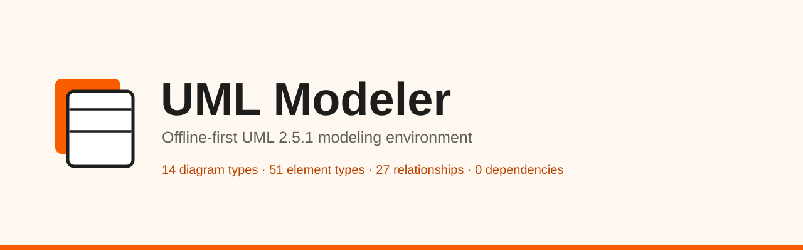
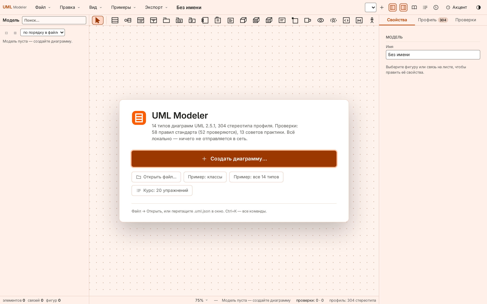
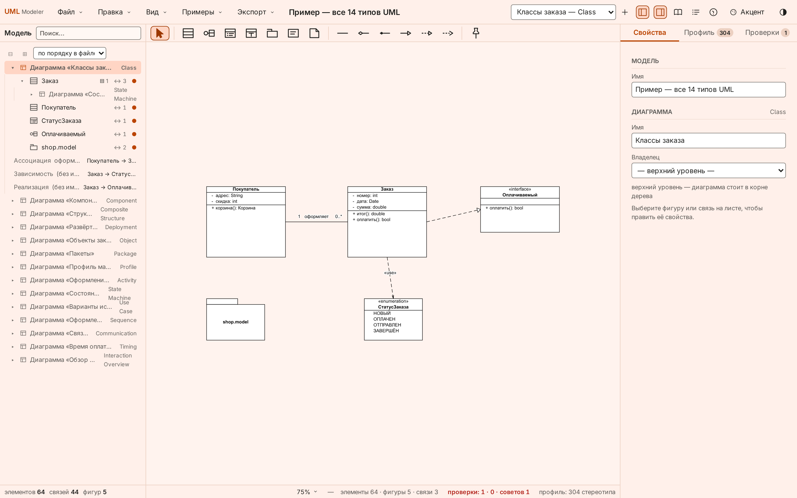
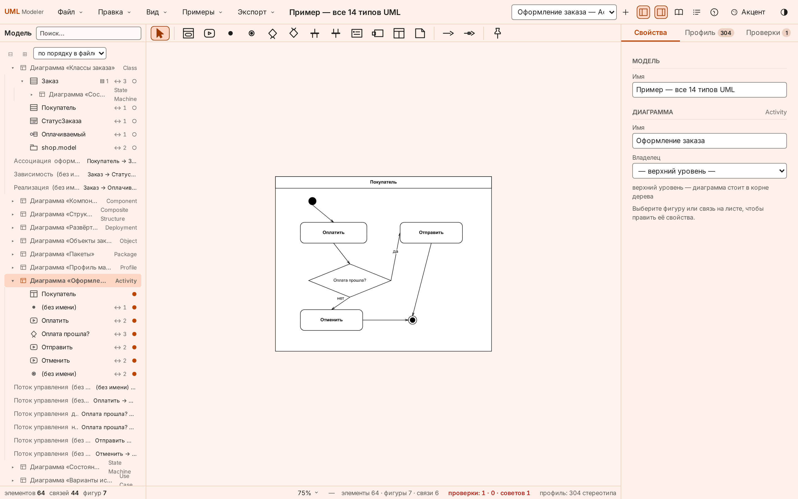
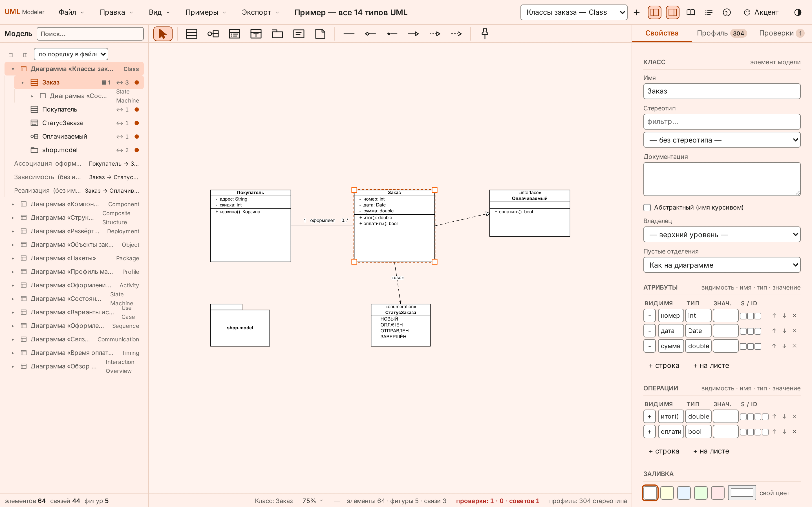
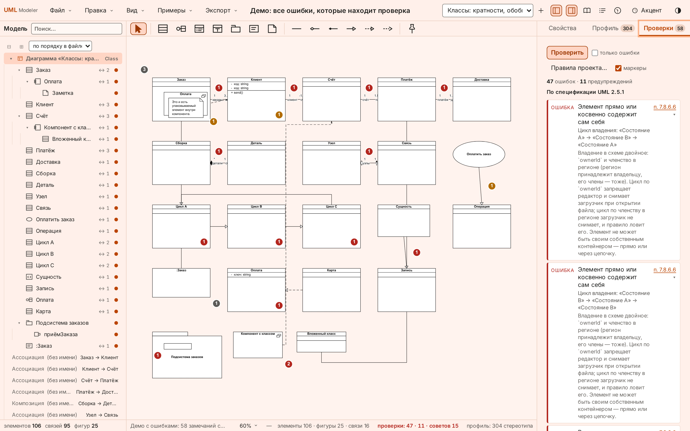

<picture>
  <source media="(prefers-color-scheme: dark)" srcset="assets/banner-dark.svg">
  
</picture>

# UML Modeler

Офлайн-редактор UML-диаграмм: vanilla ES-модули и SVG, без сборщика, без npm-зависимостей,
без бэкенда; модель отделена от вида, а проверка модели — такая же часть продукта, как рисование.

`офлайн · UML 2.5.1 · ноль зависимостей · Apache-2.0 · 18 наборов проверок, 958 проверок · 14 типов диаграмм`

## Summary (EN)

- A browser UML 2.5.1 diagram editor built from plain ES modules and SVG: no bundler, no npm dependencies, no server, no build step.
- Model and view are separate: `elements[]` and `relationships[]` are the model, `diagrams[].shapes[]` is a view that stores only geometry and a reference.
- Serialization is canonical and byte-stable; a 4 611-byte legacy fixture must stay byte-identical on every run.
- Coverage: 14 diagram types, 51 palette shapes, 27 relationship kinds, 304 canonical stereotypes.
- Validation is a first-class subsystem: 71 rules in four layers, plus a registry of 449 UML 2.5.1 constraints with explicit statuses.
- 18 test suites, 958 checks, one command; browser suites drive a real page in headless Chromium over CDP without any package.
- Nothing is fetched at runtime — the application makes zero external loads.

## Содержание

1. [Что это и зачем](#1-что-это-и-зачем)
2. [Скриншоты](#2-скриншоты)
3. [Возможности](#3-возможности)
4. [Поддержка UML](#4-поддержка-uml)
5. [Архитектура](#5-архитектура)
6. [Движок проверок](#6-движок-проверок)
7. [Модель данных и сериализация](#7-модель-данных-и-сериализация)
8. [Быстрый старт](#8-быстрый-старт)
9. [Как пользоваться](#9-как-пользоваться)
10. [Тестирование и качество](#10-тестирование-и-качество)
11. [Структура проекта](#11-структура-проекта)
12. [Разработка](#12-разработка)
13. [Дорожная карта и ограничения](#13-дорожная-карта-и-ограничения)
14. [Как это проверено](#14-как-это-проверено)
15. [Как написан этот проект](#15-как-написан-этот-проект)
16. [Участие, лицензия и благодарности](#16-участие-лицензия-и-благодарности)

---

## 1. Что это и зачем

Инструмент, в котором диаграмма — это вид на модель, а не сама модель; поэтому одна правка
видна на всех листах, а файл остаётся сравним побайтово.

Продукт рассчитан на прохождение учебного пособия ВМК МГУ: 3 главы и 20 упражнений; из
52 рисунков пособия 48 — диаграммы, и все 48 воспроизведены как модели в `app/course/figures/`
(остальные четыре — снимки интерфейса, диаграммами не являются; у упражнения 3.3 рисунков нет
вовсе). Те же 48 моделей лежат в корпусе и прогоняются против панели «Проверки».

| Принцип | Как это видно в файле | Что из этого следует |
|---|---|---|
| Модель отделена от вида | `elements[]`, `relationships[]` против `diagrams[].shapes[]`, `diagrams[].links[]` | переименование элемента — одна правка и сразу на всех диаграммах |
| Один элемент — много листов | фигура хранит `elementId`, вид связи — `relId` | `Delete` снимает вид, `Shift+Delete` удаляет из модели |
| Детерминированная запись | фиксированный порядок ключей, умолчания не пишутся | два одинаковых состояния дают побайтово одинаковый `.uml.json` |
| Офлайн | нет `src=`/`href=` на внешние адреса, нет `@import`, нет `url(http…)`; шрифты — локальные `woff2` | сеть не нужна ни для запуска, ни для справки, ни для проверки пункта стандарта |
| Проверка — часть продукта | 71 правило в четырёх слоях, реестр из 449 констрейнтов | модель можно не только нарисовать, но и прочитать машиной |

Чего документ не утверждает: что продукт покрывает UML 2.5.1 целиком. Покрытие измерено и
приведено в [§4](#4-поддержка-uml) с числами и статусами, включая то, чего модель не выражает.

## 2. Скриншоты

Пять снимков собранного приложения в двух темах: светлый набор показывается в светлой теме
GitHub, тёмный — в тёмной (`<picture>` с `prefers-color-scheme`, как у баннера). Оба набора
снимаются одной командой `cd app && node tools/shots.mjs` (headless-Chromium по CDP,
1440×900 при масштабе 2, без npm) с той же страницы, которую открывает человек; тема
фиксируется эмуляцией до навигации, поэтому кадры воспроизводимы, а не «какая получилась».

<picture>
  <source media="(prefers-color-scheme: dark)" srcset="assets/screenshots/main-canvas-dark.png">
  
</picture>

*Основной экран: полоса инструментов над листом, дерево модели слева, инспектор «Свойства» справа.*

<picture>
  <source media="(prefers-color-scheme: dark)" srcset="assets/screenshots/class-diagram-dark.png">
  
</picture>

*Диаграмма классов: члены задаются полями модели, кратности и роли — свойствами концов связи.*

<picture>
  <source media="(prefers-color-scheme: dark)" srcset="assets/screenshots/activity-partitions-dark.png">
  
</picture>

*Диаграмма деятельности: дорожки делят лист, узел помнит свою дорожку, поток объектов отличается от потока управления.*

<picture>
  <source media="(prefers-color-scheme: dark)" srcset="assets/screenshots/inspector-tree-dark.png">
  
</picture>

*Инспектор: стереотип и tagged values элемента модели, «Показан на: N листах», вложенные диаграммы.*

<picture>
  <source media="(prefers-color-scheme: dark)" srcset="assets/screenshots/validation-dark.png">
  
</picture>

*Панель «Проверки»: замечание стандарта с кнопкой пункта, совет практики без пункта и счётчики слоёв в статусбаре.*

## 3. Возможности

Подсистемы перечислены по тому, что человек делает, а не по каталогам кода; в третьем столбце —
граница, за которую подсистема не выходит.

| Подсистема | Что умеет | Граница |
|---|---|---|
| Редактор диаграмм | 14 типов; палитра, клавиши и инспектор меняются вместе с типом; инструмент «Держать» оставляет выбор после постановки (по умолчанию выключен); редактор имени открывается сам; хитбокс актёра, линии жизни и узла — вся рамка фигуры; сетка 10 px с привязкой | фигура хранит только геометрию и ссылку: имени, стереотипа и членов в ней нет |
| UML-моделирование | `abstract`, статические, производные и `{id}` члены, `navigable`, агрегация на конце, квалификаторы, наборы обобщений, `trigger`/`guard`/`effect`, регионы, операнды фрагментов, `seq` у сообщений, tagged values, стереотип у элемента и у связи | кратности у члена модели нет, видимости элемента нет — из-за отсутствующих полей часть констрейнтов стандарта остаётся невыразимой ([§4](#4-поддержка-uml)) |
| Управление моделью | дерево по владельцу (корень — диаграммы), «Показан на: N листах», вложенные диаграммы с переносом владельца, вложения файлов до 2 МБ внутри `.uml.json` | диаграмма не может принадлежать элементу, который на ней показан |
| Представление | 6 акцентов интерфейса, светлая, тёмная и «как в системе» темы, масштаб 50–150 % и «вписать», пиктограммы стереотипов (флаг живёт в модели), печать A4 одной диаграммы и всех | масштаба нет в меню «Вид»: им владеет строка состояния |
| Навигация | палитра команд `Ctrl+K` (действия меню, инструменты, виды), поиск по модели (имя, вид, стереотип, документация, связи), `F1` — статья нотации для выделенного, справочник из семи полок с поиском сразу по всем | `F1` без статьи даёт строку в статусбаре, а не пустую панель |
| Редактирование | отмена и повтор на 100 шагов, копирование с переносом между листами (на чужом листе вставляется вид существующего элемента), лассо и `Shift`-клик, шесть выравниваний и два распределения, авто-раскладка, контекстное меню на фигуре, связи и пустом месте, изломы линии (`waypoints`) и скачки на пересечениях | авто-раскладка называет потерю до применения: ручные точки будут потеряны |
| Сохранение | автосохранение черновика в `localStorage`, канонический `.uml.json`, ремонт оборванного JSON до 32 МБ, миграции `uml-model/2` и `uml-class-diagram/1` | ремонт — второй проход по тексту: файл больше 32 МБ получает отказ, а не «починку» |
| Импорт и экспорт | импорт PlantUML на новый лист (файл или вставленный текст), SVG, PNG ×1 и ×2, JSON «как на диск», печать этой диаграммы и всех диаграмм в PDF, экспорт всего проекта (один `.json` плюс SVG на диаграмму) | экспорта в PlantUML в меню нет: разбор текста есть, обратной записи в поставку не выведено |
| Справочник | семь полок: нотация, правила движка, реестр констрейнтов, спецификация, пособие, стереотипы, PlantUML; `F1`, поиск по всем полкам, переключатель «оригинал / русский» (английская сторона — номера пунктов, заголовки и OCL без прозы; перевод разделов полный) | справочник открывается рядом с листом, а не вместо него; перевод стандарта необязателен, оригинал обязан открываться и без него |
| Проверки | четыре слоя в одной панели, счётчик в статусбаре по слоям, переход к виноватому объекту и листу, «только ошибки», список «не проверяется», изоляция сбоя правила | проверки ничего не блокируют: модель с нарушениями сохраняется и открывается как обычная |

## 4. Поддержка UML

Числа ниже — из данных нотации и из реестра покрытия; каждая строка проверяема командой из
[§14](#14-как-это-проверено).

**14 типов диаграмм, 51 фигура, 27 связей.** Палитры типов пересекаются: одна и та же фигура
встречается на нескольких листах, поэтому в 14 палитрах 93 кнопки фигур и 48 кнопок связей при
51 и 27 уникальных видах.

| Тип | id | Группа | Фигур в палитре | Связей в палитре |
|---|---|---|---|---|
| Классов | `class` | структурная | 7 | 6 |
| Компонентов | `component` | структурная | 7 | 5 |
| Композитной структуры | `composite` | структурная | 7 | 4 |
| Развёртывания | `deployment` | структурная | 8 | 5 |
| Объектов | `object` | структурная | 4 | 3 |
| Пакетов | `package` | структурная | 5 | 5 |
| Профилей | `profile` | структурная | 6 | 4 |
| Деятельности | `activity` | поведенческая | 12 | 2 |
| Состояний | `state` | поведенческая | 11 | 1 |
| Вариантов использования | `usecase` | поведенческая | 5 | 5 |
| Последовательности | `sequence` | поведенческая | 6 | 4 |
| Коммуникации | `communication` | поведенческая | 4 | 2 |
| Времени | `timing` | поведенческая | 2 | 1 |
| Обзора взаимодействий | `interaction-overview` | поведенческая | 9 | 1 |

**Стереотипы.** Профиль собран из 428 записей: 407 расширений после слияния дублей, 304
стереотипа после канонизации имён, 9 псевдонимов, 15 рисунков. Стереотип назначается и
элементу, и связи; tagged values правятся в инспекторе.

**Свойства модели** (необязательные поля; файл без них открывается и пересохраняется теми же
байтами):

| Поле | Где | Что даёт на листе |
|---|---|---|
| `abstract` | элемент | имя курсивом |
| `isStatic`, `isDerived`, `isID` | член | подчёркивание, `/`, `{id}` |
| `navigable`, `fromRole`/`toRole` | связь | открытая стрелка, имя полюса |
| `fromAggregation`/`toAggregation` | связь | полый или залитый ромб |
| `setId` + `generalizationSets[]` | связь и модель | `{complete, disjoint}` |
| `trigger`/`guard`/`effect` | переход | подпись `событие [условие] / действие` |
| `operands[]` | фрагмент | разделители и сторожи операндов |
| `waypoints`, `rounded`, `lineJumps` | вид связи | изломы, скругление, скачок на пересечении |

**Матрица покрытия констрейнтов UML 2.5.1.** Реестр собран из стандарта, у каждого констрейнта
есть статус; реестр — данные, а не проза.

| Статус | Констрейнтов | Что значит |
|---|---|---|
| всего в реестре | 449 | все констрейнты стандарта, попавшие в разбор |
| в области | 166 | применимы к модели этого формата |
| вне области | 283 | не применимы: метакласс не представлен ни одной фигурой или связью нотации |
| `executable` | 52 | есть функция-проверка |
| `gap` | 87 | применимы, но правила ещё не написаны |
| `tautology` | 3 | ситуацию нельзя записать в файл: `from`/`to` всегда два |
| `no-ocl` | 24 | у констрейнта в стандарте нет OCL — сверять не с чем |
| `todo` | 0 | очередь разобрана |

Оговорка, без которой таблица читается неверно: **58 правил стандарта — это не «58 из 449»**.
Считаются разные единицы: реестр считает констрейнты стандарта, набор — правила. Арифметика
набора: 58 = 52 исполняемых + 6 невыразимых. Арифметика реестра: 449 = 52 + 87 + 3 + 24 + 283,
и в области 166 = 52 + 87 + 3 + 24. Поэтому «покрыто 58 из 449» было бы неправдой в обе стороны:
283 констрейнта к этой модели не относятся вовсе (это не долг), а 87 применимых — долг.

Шесть правил стандарта записаны в набор как невыразимые, с названным недостающим полем:
`association-specialization-ends`, `association-end-typed`, `stereotype-binary-association`,
`usecase-binary-association`, `transition-same-container`, `package-element-visibility`.
Три из них — тавтологии схемы, два упираются в отсутствующее поле, одно невозможно по конструкции.

## 5. Архитектура

Направление зависимостей одно: сверху вниз, и слой модели не знает ни про DOM, ни про состояние.

```
main.js · index.html
   │
   ▼
ui/          render · canvas · panels · toolbar · toolstrip · commands · checks · reference
   │
   ├─ rules/    engine · registry · правила по темам · dsl/project · coverage
   ├─ state/    store: состояние, история, автосохранение
   ├─ io/       umljson · json-repair · plantuml · stereotypes
   │
   ▼
model/       model · notation · geometry · layout · auto-route · parallel-links · sample
   ▲
   │  данные нотации читаются одним файлом
notation/uml.json    фигуры · связи · палитры · клавиши · стили · размеры
```

| Каталог | Файлов `.js` | Знает про | Не знает про |
|---|---|---|---|
| `app/src/model/` | 10 | себя и `util.js` | DOM, состояние, интерфейс |
| `app/src/io/` | 5 | `model/` | DOM, интерфейс |
| `app/src/state/` | 1 | `model/` | DOM, интерфейс |
| `app/src/rules/` | 30 | `model/`, данные наборов | DOM (панель живёт в `ui/checks.js`) |
| `app/src/reference/` | 3 | данные справочника | модель |
| `app/src/ui/` | 22 | всё перечисленное | — |
| `app/src/vendor/archify/` | — | геометрию фигур | модель, DOM |

Всего в `app/src` — 75 файлов `.js` и 31 118 строк. Инварианты и причины, по которым они такие,
записаны в [docs/architecture/overview.md](docs/architecture/overview.md) §1–6; там же запрет
импортировать `ui/` из `model/` и требование не хардкодить числа, которые уже есть в листе
механики (`mechanics.json` → `src/mechanics.generated.js`).

**Жизненный цикл изменения** (одна дорога для мыши, клавиши, меню и `Ctrl+K`):

1. **действие** — обработчик в `ui/canvas.js`, `ui/toolbar.js` или `ui/commands.js`;
2. **команда** — функция меняет модель через `model/model.js`, а не через DOM;
3. **мутация** — правка ложится в `elements[]`/`relationships[]`/`shapes[]`, вид не хранит смысла;
4. **история** — снимок модели в `state/store.js`, глубина 100 (`MAX_HISTORY`);
5. **рендер** — `ui/render.js` перерисовывает лист из модели, а `ui/checks.js` пересчитывает
   замечания по новой ревизии.

Следствие: отмена возвращает модель, а не только экран — иначе файл и панель проверок разошлись бы
с тем, что видно на листе.

## 6. Движок проверок

Четыре слоя различаются происхождением правила, а не строгостью; поэтому у замечания разная
обвязка, а в статусбаре разные счётчики.

| Слой | Откуда правило | Чем подтверждается | Счётчик |
|---|---|---|---|
| стандарт | `app/notation/rules/uml-2.5.1.json`, 58 правил | пункт, имя констрейнта, дословный текст, OCL и страница | `проверки: E · W` |
| практика | `app/notation/rules/practice.json`, 13 советов | `rationale`; пункта нет, и это не пробел, а природа слоя | `· советов N` |
| проект | `projectRules[]` в файле модели | текст самого правила; договорённость команды | `· проект N` |
| геометрия листа | `src/vendor/archify/geometry-adapter.mjs` | свойство рисунка, а не модели | `· раскладка N` |

**Из чего состоит правило.** Поля обязательные: набор не загрузится, если чего-то не хватает —
отказ виден в панели («проверки: —» с причиной), а не проглатывается.

| Поле | Смысл | Проверка при загрузке |
|---|---|---|
| `id` | имя правила | дубликат `id` — отказ набора |
| `level` | `error` или `warning` | иное значение — отказ |
| `appliesTo` | к каким видам применимо | — |
| `check` | ключ функции в `src/rules/registry.js` | ключа нет в реестре и правило не невыразимо — отказ |
| `source` | пункт, констрейнт, текст, OCL, страница | у правила стандарта без `source.clause` — отказ |
| `rationale` | почему такую модель труднее читать | у практики пустой `rationale` — отказ; `source` у практики — тоже |
| `message` | формулировка нарушения, одна на правило | — |
| `hint` | как исправить и **когда правило молчит** | — |

**«Правило молчит»** — не дефект, а названная граница. Буквальный OCL судит недорисованное как
нарушение, проверка — нет; граница описана в `hint`, а не спрятана в коде.

| Случай | Почему молчит | Замер |
|---|---|---|
| элемент без связей | заметки, пакеты, дорожки, порты, фрагменты стоят на листе сами по себе по природе | список `STANDALONE`; наивное правило давало 137 срабатываний на 48 моделях корпуса, после границы — 96 |
| модель без фигур | файл вправе хранить модель без видов; иначе «не показан» получил бы каждый элемент | граница `hasAnyView` |
| фрагмент без операндов | пустой фрагмент — заготовка, а не ошибка | 26 из 27 фрагментов корпуса без операндов дали бы ложные срабатывания |
| фигура без единой связи у узлов деятельности | у псевдосостояний нормальное состояние — «ещё не соединено» | 7 правил с этой границей |

**Сбой правила не убивает прогон.** Бросившее исключение правило даёт одну запись
`status: 'failed'`, отключается до конца прогона, остальные замечания остаются. Сбой не входит в
счётчик нарушений, но виден: отдельный раздел «Проверки, которые не выполнились», хвост
`· не проверено N` в статусбаре, и «все чисто» при нём не пишется — вместо него «Нарушений не
найдено среди отработавших правил».

**Демо «все ошибки»** — модель `app/material/demo-errors.json`: 9 диаграмм, 106 элементов,
95 связей, по одному нарушению на каждое из 65 правил с функцией. Прогон даёт 73 замечания
(58 стандарта и 15 советов): правила о циклах дают по замечанию на каждого участника, поэтому
замечаний больше, чем правил. Набор `demo` краснеет, если новое правило с функцией не показано в
демо. Разбор по-человечески — [app/material/DEMO-ERRORS.md](app/material/DEMO-ERRORS.md), как
читать панель — [docs/uml/validation.md](docs/uml/validation.md).

## 7. Модель данных и сериализация

Формат один — `uml-model/3`; запись каноническая, чтение — с ремонтом и миграцией.

```json
{
  "schema": "uml-model/3",
  "elements": [ { "id": "e1", "kind": "class", "name": "Заказ" } ],
  "relationships": [ { "id": "r1", "kind": "association", "from": "e2", "to": "e1" } ],
  "diagrams": [ {
    "id": "d1", "kind": "class",
    "shapes": [ { "id": "s1", "elementId": "e1", "x": 600, "y": 60, "w": 190, "h": 170 } ],
    "links":  [ { "id": "l1", "relId": "r1", "from": { "shapeId": "s2" }, "to": { "shapeId": "s1" } } ]
  } ]
}
```

| Свойство | Как обеспечено |
|---|---|
| порядок ключей | списки ключей в `src/io/umljson.js`; новый ключ без записи в список и в тест — не проходит |
| умолчания не пишутся | `public`, `t=0.5`, прямой маршрут, пустые списки в файл не попадают |
| порядок вычисляется | номер сообщения на диаграмме последовательности — это его `y`, а не поле |
| обратная совместимость | эталон [tests/fixtures/old-v3.json](tests/fixtures/old-v3.json), 4 611 Б, md5 `3d600cf08dc26b3329489331de80f3f6`; обязан пересохраняться побайтово, проверяется прогоном |
| миграция | `uml-model/2` (связи лежали в диаграмме) и `uml-class-diagram/1` читаются без потери данных; запись всегда `uml-model/3` |

**Битый файл.** Обрыв (закрытая вкладка, полный диск) не даёт исключения «некорректный JSON»:

1. один проход по тексту запоминает точки, где значение закончилось, и какие скобки были открыты
   (скобки внутри строк не считаются);
2. разбор упал — берутся точки с конца: префикс плюс недостающие закрывающие скобки, первый
   разобравшийся префикс и есть восстановление;
3. не вышло — внятная ошибка с позицией, строкой и столбцом, без стека.

Каждое восстановление — строка в `repairs` и тост с числом исправлений: ремонт никогда не молчит.
Предел — 32 МБ (`MAX_REPAIR_BYTES` в `src/io/json-repair.js`): выше него файл получает отказ.

## 8. Быстрый старт

Нужен браузер; Node нужен только для тестов и сборки. Замерено на Node 24.20.0.

```sh
cd app && node tools/verify.mjs     # 18 наборов, сверка двух копий, реестр покрытия, эталон
cd app && ./serve.sh               # http://localhost:8123, порт ищется вверх от 8123
```

Открывать нужно через сервер: ES-модули не грузятся с `file://` — это ограничение браузера, а не
приложения. Человек открывает сборку `app/dist/index.html`, разработчик — `app/index.html`; оба
через `./serve.sh` из папки `app`.

Первый проект: «Начало работы» → «Создать диаграмму…» → выбрать тип → поставить фигуры из полосы
над листом → сохранить `Ctrl+S`. Пустая модель при этом настоящая: ноль диаграмм, панели и
инструменты работают как обычно.

## 9. Как пользоваться

Сценарии короткие и проверяемые: каждый шаг — пункт меню или клавиша, которые есть в приложении.

| Сценарий | Шаги |
|---|---|
| Создать модель и диаграмму | «Файл → Новая модель»; «+» у списка диаграмм; имя и тип; `Enter` |
| Связать элементы | выбрать инструмент связи в полосе (или клавишу типа, например `A` — ассоциация); протянуть от фигуры к фигуре; двойной клик по линии — имя и кратности |
| Показать элемент на втором листе | перетащить строку дерева на лист; уже показанный — подсветится вместо дубля |
| Проверить модель | вкладка «Проверки» справа; клик по замечанию переключает лист и выделяет объект; `F1` на фигуре открывает статью нотации |
| Сохранить и открыть | `Ctrl+S` пишет канонический `.uml.json`; «Файл → Открыть…» (`Ctrl+O`) читает его обратно, включая старые схемы |
| Отдать диаграмму | «Экспорт → SVG этой диаграммы», «PNG ×2», «Печать этой диаграммы (PDF)» или «Экспорт всего проекта…» |
| Посмотреть все ошибки | «Примеры → Пример с ошибками (проверки)…»: 9 листов, 73 замечания, каждое ведёт к нарушению |

## 10. Тестирование и качество

Один прогон запускает 18 наборов; сумма проверок — 958. Набор, лежащий в `app/tests/` вне списка
`SUITES`, печатается как замечание: проверка без запуска набором не считается.

| Набор | Проверок | Что доказывает |
|---|---|---|
| `types` | 275 | все 14 типов и правила «модель/вид» в настоящей странице: стереотипы, номера сообщений, панель проверок |
| `rules` | 293 | движок правил: пункт у каждого правила, реестр, пары фикстур, изоляция сбоя, путь цикла, детерминизм |
| `connectors` | 86 | связей: маркеры на конце, глубочайшая цель под курсором, доли концов, кривая как сплайн, изломы |
| `layout` | 67 | авто-раскладка как добровольная команда: ранги, зазоры, отсутствие пересечений, отказ на последовательности |
| `smoke` | 45 | 45 сценариев интерфейса: палитра, правка, две команды удаления, профиль, файл, миграция, лассо |
| `geometry-panel` | 26 | четвёртый слой проверок в интерфейсе: раздел, число строк, чип «раскладка», переход к фигуре |
| `project-rules` | 25 | DSL правил проекта: белый список полей и операторов, `glob` без регулярных выражений, круг «сохранить → открыть» |
| `plantuml-import` | 24 | импорт PlantUML: разбор, круг по 48 моделям корпуса, неподвижная точка «разбор → запись → разбор» |
| `shape-types` | 22 | словарь 834 видов: файл цел, снят с того самого источника, каждый наш вид ведёт к своему классу модели |
| `stereotype-hygiene` | 20 | гигиена имён стереотипов: одно имя на одном базовом типе, границы правил, корпус из 48 моделей |
| `stereotypes` | 16 | профиль: 304 стереотипа, 407 расширений, псевдонимы, tagged-определения, битая ссылка в `repairs` |
| `recovery` | 14 | пять случаев битого файла, предел 32 МБ, эталон побайтово, круг «экспорт проекта → открыть → экспорт» |
| `auto-route` | 11 | перепривязка концов после раскладки: стороны, доли, идемпотентность |
| `corpus` | 10 | 48 моделей пособия против панели «Проверки»: ноль замечаний стандарта, подложенные поломки ловятся |
| `theme` | 10 | светлая, тёмная и системная темы: выбор читается до первой отрисовки, контраст считается |
| `demo` | 7 | каждое правило с функцией даёт находку в демо-модели и ни одно замечание не ссылается в пустоту |
| `geometry` | 7 | проверки раскладки как чистый узел, без браузера |
| `gaps` | 0 (19 кодов) | счётчик пробелов корпуса: 19 кодов, осталось 0 — не проверки, а коды состояния |
| **итого** | **958** | |

Шесть наборов поднимают локальный сервер и headless-Chromium по CDP, без единого пакета:
`types`, `smoke`, `connectors`, `layout`, `geometry-panel`, `theme`. Остальные двенадцать работают
вовсе без браузера. Регрессия держится на двух вещах: сверке `src` ↔ `dist` (526 файлов,
0 расхождений) и эталоне `old-v3.json`.
Новая проверка добавляется файлом в `app/tests/`, строкой в `SUITES` в
[app/tools/verify.mjs](app/tools/verify.mjs) и — если это сценарий — тем же стендом, что у соседей.

## 11. Структура проекта

```
app/
  index.html            оболочка: панели, полоса инструментов, лист, читалка справочника
  src/model/            модель, нотация, геометрия линии, раскладка, авто-маршрут
  src/io/               чтение, ремонт, миграция и запись .uml.json; стереотипы; PlantUML
  src/rules/            движок проверок, реестр, по файлу на тему правил, DSL правил проекта
  src/state/            состояние, история на 100 шагов, автосохранение
  src/ui/               рендер, канва, панели, меню, палитра команд, проверки, справочник
  src/brand/            акцент, шрифты Inter (woff2 + лицензия), набор иконок и пиктограмм
  src/vendor/archify/   вендорная копия проверок геометрии листа (лицензия рядом)
  notation/uml.json     14 типов: фигуры, связи, палитры, клавиши, стили, размеры
  notation/rules/       uml-2.5.1.json (58), practice.json (13), coverage.json (449)
  notation/shape-types.json  словарь 834 видов и класс модели, который каждый строит
  profile/              стереотипы: 304 записи, которые приложение читает на старте
  course/               3 главы, 20 упражнений, 48 моделей-копий, тексты упражнений
  reference/            справочник: полки, поиск, спецификация, перевод, рисунки пособия
  material/             материалы сборки данных и демо-модель с ошибками
  tests/                20 наборов проверок и данные для них
  tools/                скрипты сборки данных и единый прогон verify.mjs
  build.mjs             «сборка» = копия сайта в dist/ плюс mechanics.generated.js
  serve.sh              статический сервер; --screenshot снимает окно
  dist/                 сборка, её открывает человек (в репозиторий не входит)
docs/
  architecture/         инварианты слоёв и разбор «модель против вида»
  uml/                  как читать проверки, профиль и стереотипы, нотация, пиктограммы
  user-guide/           операции собранного приложения, импорт PlantUML
  research/             исследования, аудиты и планы (историческое, не руководство)
material/               корпус из 48 моделей, реестр покрытия, перевод спецификации, профиль
tests/                  корпус и эталон обратной совместимости old-v3.json
assets/                 баннеры и снимки для этого README
```

Справочник существует в двух видах. Локально `app/reference/spec/` несёт **полный**
английский текст стандарта — для личного чтения, в репозиторий он не входит.
Отсюда два режима сборки — и различаются они ровно этим каталогом:

```sh
cd app
node build.mjs              # поставка: без прозы, такую сборку можно публиковать
node build.mjs --with-spec  # локально: с полным английским текстом, для чтения
```

Причина — условие (2) лицензии OMG, которое запрещает раздавать текст стандарта
по сети; страница `reference/NOTICE.md` в самом приложении говорит об этом же,
а не прячет. Русский перевод входит в обе сборки.

## 12. Разработка

Читать код стоит в порядке зависимостей: `model/notation.js` → `model/model.js` →
`io/umljson.js` → `state/store.js` → `ui/render.js` → `ui/canvas.js` → `ui/commands.js`. Так видно,
что смысл живёт в модели, а интерфейс только вызывает.

**Новое правило.** Шесть шагов, все — файлы, а не «настройки»:

1. проверить, что модель выражает нужные данные; не выражает — не правило, а запись в
   `NOT_EXPRESSIBLE` с названным полем;
2. строка в `notation/rules/uml-2.5.1.json` (или `practice.json`): `id`, `level`, `appliesTo`,
   `check`, `message`, `hint` с границей «когда молчит», плюс `source` или `rationale`;
3. функция в `src/rules/<тема>.js` и запись `check → функция` в `src/rules/registry.js`;
4. пара фикстур в `app/tests/data/rules/`: нарушение ловится, контрольная чиста;
5. нарушение в `app/material/demo-errors.json` и строка в `DEMO-ERRORS.md` — иначе `demo` красный;
6. `node material/rules-coverage/build.mjs` (из корня репозитория), затем
   `cd app && node tools/verify.mjs`.

**Новая фигура.** Запись в `notation/uml.json` (`shapes`), добавление в палитру нужного типа и — если
нужен новый способ рисования — новый `style` в таблице `RENDERERS` в `src/ui/render.js`. Ветвление
по конкретной фигуре в рендерере считается ошибкой: рендерер выбирает функцию по `style`.

**Новый тип диаграммы.** Запись в `types` плюс id в `typeOrder`, палитра, словарь `keys`, иконка, и
набор `types` проверяет, что тип доступен из списка диаграмм.

| Команда | Что делает |
|---|---|
| `cd app && node build.mjs` | копия сайта в `dist/` и `src/mechanics.generated.js` из `mechanics.json`; без флага — сборка без прозы стандарта (`--with-spec` — локальная, с текстом) |
| `cd app && node tools/verify.mjs` | 18 наборов, сверка копий, реестр покрытия, эталон; код 1 при любом красном |
| `cd app && node tools/build-course.mjs --check` | данные курса совпадают с пособием, ничего не пишется |
| `cd app && node tools/build-reference.mjs` | пересборка справочника из `material/reference-content/` |
| `cd app && node tools/check-reference.mjs` | связи, поиск и полнота собранного справочника |
| `node material/rules-coverage/build.mjs --check` | каталог покрытия не разошёлся с набором правил (из корня репозитория) |

## 13. Дорожная карта и ограничения

Состояние честное: сделано много, но не всё, и часть ограничений — свойство формата, а не долг.

| Статус | Что |
|---|---|
| Implemented | 14 типов, 51 фигура, 27 связей; профиль 304 стереотипа; модель/вид; вложенные диаграммы; проверки в четырёх слоях; правила проекта; ремонт битого файла; импорт PlantUML; экспорт SVG/PNG/PDF/проекта; справочник; курс из 20 упражнений |
| In progress | пачки правил по `gap`-констрейнтам: очередь и её состояние ведутся в [material/rules-coverage/TO-IMPLEMENT.md](material/rules-coverage/TO-IMPLEMENT.md), счётчики — в `report.md` рядом |
| Planned | правила об актёрах и действующих лицах — дефект D2 ниже |
| Future | два из шести невыразимых станут возможны, когда модель начнёт выражать нужные данные: видимость элемента; содержащая машина состояний и `local` у перехода |

Известные ограничения и дефекты, которые не спрятаны:

- **D2, «все чисто» на модели с тремя актёрами.** На модели упражнения 3.1 с тремя основными
  действующими лицами панель не показывает замечаний, хотя показывать должна: три правила об
  актёрах были в дереве и откатились вместе с откатом `src` в один проход, в текущую сборку не
  возвращались.
- **Линия под двойным маркером не укорачивается.** Открытая мелочь слоя связей: при двух маркерах
  на одном конце линия не укорачивается, как должна.
- **`connectionPointType` не тронут.** Точка привязки конца связи задаётся стороной и долей, отдельного
  типа точки соединения в модели нет.
- **Подпись на голове линии жизни** центрируется; ожидаемое положение — вверху (`y=0`).
- **6 невыразимых правил стандарта** — с названным недостающим полем, показаны в панели свёрнутым
  списком, а не выключены молча.
- **87 `gap`-констрейнтов** применимы к модели, но правила для них не написаны; реестр говорит об
  этом статусом, а не умалчивает.
- **Корпус неполон как модель:** у 17 из 48 моделей нет ни одной связи, у 20 есть изолированный
  элемент — это дефект корпуса, а не правил, и он виден в числах слоя практики.

## 14. Как это проверено

Каждое число в этом документе печатается командой; ниже — соответствие «число → команда». Все
команды выполняются из корня репозитория, кроме тех, что начинаются с `cd app`.

```sh
# 18 наборов, сверка src ↔ dist, реестр покрытия, эталон; код возврата 1, если что-то красное
cd app && node tools/verify.mjs

# 14 типов, 51 фигура, 27 связей
cd app && node -e 'const u=require("./notation/uml.json");console.log(Object.keys(u.types).length,Object.keys(u.shapes).length,Object.keys(u.connectors).length)'

# 45 «строительных» видов и 834 записи словаря
cd app && node -e 'const s=require("./notation/shape-types.json");console.log(Object.keys(s.buildKinds).length,Object.keys(s.types).length)'

# 449 / 166 / 283 и распределение по статусам
cd app && node -e 'const c=require("./notation/rules/coverage.json");console.log(c.totals,c.byStatus)'

# 58 + 13 = 71 правило; 48 ошибок и 10 предупреждений в наборе стандарта
cd app && node -e 'const r=require("./notation/rules/uml-2.5.1.json"),p=require("./notation/rules/practice.json");console.log(r.length,p.length,r.filter(x=>x.level==="error").length)'

# 65 записей в реестре проверок
cd app && node --input-type=module -e 'import("./src/rules/registry.js").then(m=>console.log(Object.keys(m.CHECKS).length))'

# 304 стереотипа, 407 расширений, 428 записей, 9 псевдонимов, 15 рисунков
cd app && node -e 'console.log(require("./profile/stereotypes.json").counts)'

# объём кода: файлы и строки
cd app && find src -name '*.js' | wc -l && find src -name '*.js' -exec cat {} + | wc -l

# объём сборки: файлы и байты
cd app && find dist -type f | wc -l && du -sb dist

# офлайн: ни одной внешней загрузки (четыре шаблона, ожидается 0)
cd app && grep -rIn -e 'src="http' -e 'href="http' -e 'url(http' -e '@import' src index.html | wc -l

# шрифты лежат в репозитории
cd app && ls src/brand/fonts/*.woff2 | wc -l

# эталон обратной совместимости не изменился
md5sum tests/fixtures/old-v3.json

# один набор отдельно — по имени из таблицы §10
cd app && node tests/rules.mjs
```

Числа, которые зависят от состояния рабочей копии (объём `src`, число файлов в `dist`), сняты на
момент последнего прогона и печатаются теми же командами заново. Если строка в этом README
разойдётся с выводом — верна команда, а не строка.

## 15. Как написан этот проект

Код и документация написаны ИИ-агентами под управлением владельца продукта. Агенты работают на
DeepSeek Harness (DSH).

Отсюда три особенности, заметные в репозитории: числа в документации принято сопровождать
командой, которой они получены; «не вышло» и «не сделано» пишется явно, а не растворяется в тексте;
проверка, которая лежит в `app/tests/`, но не входит ни в один набор, считается отсутствующей —
`tools/verify.mjs` печатает её как замечание. Раздел [§14](#14-как-это-проверено) существует по той
же причине: утверждение без команды в этом проекте не считается утверждением.

## 16. Участие, лицензия и благодарности

Как участвовать и какие правила работы в репозитории — [CONTRIBUTING.md](CONTRIBUTING.md); как
сообщать об уязвимостях — [SECURITY.md](SECURITY.md); что менялось — [CHANGELOG.md](CHANGELOG.md).

Лицензия — Apache-2.0, текст в [LICENSE](LICENSE). Сторонние материалы, стандарт, шрифты и
вендорные копии перечислены в [NOTICE](NOTICE) — единственном месте, где названы чужие права.
