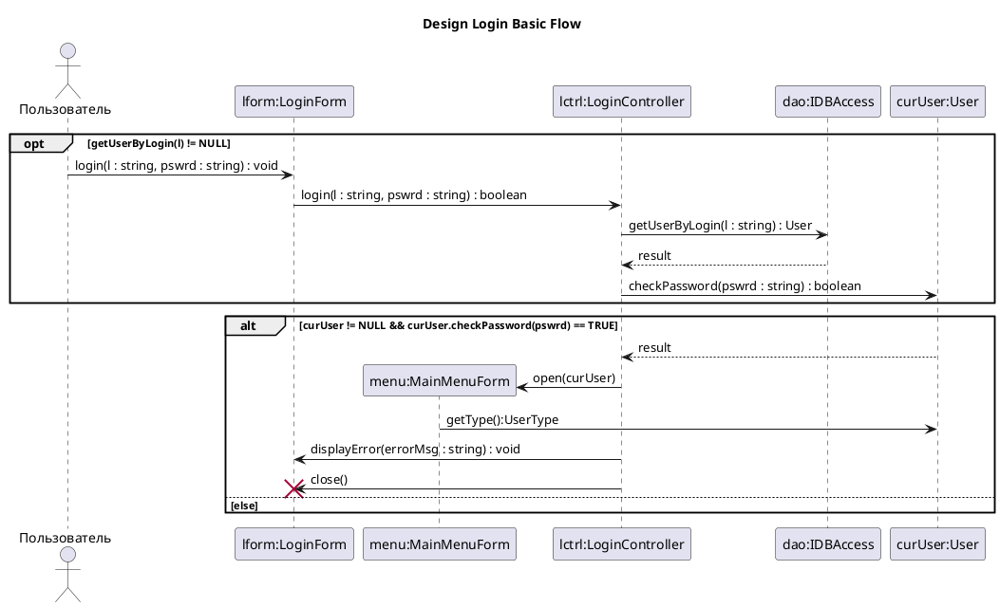

# PlantUML: экспорт диаграмм

> **Что это.** Экспорт `uml-model/3` → текст PlantUML: карта соответствия для всех
> 14 типов диаграмм, 51 фигуры и 27 связей, честный список потерь, генератор и
> проверка на настоящем `plantuml.jar`. Импорт — отдельная, более поздняя работа
> (§Э7 плана); здесь только то, что отдаёт редактор.
>
> **Зачем.** Диаграмма в git диффится текстом, вставляется в README и
> открывается в любом другом инструменте. Экспорт вдобавок фиксирует
> соответствие «наш тип ↔ синтаксис PlantUML», на которое опирается импорт
> (§7.7, §7.8 плана).

## 1. Что лежит в `material/plantuml-export/`

| Файл | Что это |
|---|---|
| `mapping.json` | Карта: 14 типов диаграмм, 51 фигура, 27 связей, 8 видов членов, стереотипы, заметки, кратности, навигация, ромбы. У каждой записи — синтаксис, пример `.puml` и ссылки на конструкции `docs/plantuml-grammar.json`. **Источник истины по соответствию.** |
| `losses.json` | 98 полей формата плюс 16 особых случаев: что переносится, что частично, что теряется и почему. **Читать до экспорта.** |
| `emit.mjs` | Генератор: `plan(model, diagram)` → структура, `emit(model)` → `.puml`, `emitAll(model)` → по файлу на диаграмму, `expectedCount(model, diagram)` → сколько сущностей ждать. Чистые функции, без DOM и без `app/`. |
| `check.mjs` | Проверка на jar: карта (регулярки + jar), 48 моделей корпуса (счёт + имена), 6 синтетических моделей типов, которых в корпусе нет, и четвёртая фаза — «что модель несёт, то в тексте названо» (без Java). |
| `roundtrip.mjs` | Круг `модель → emit → parse → модель` через настоящий разборщик редактора: печатает, сколько моделей совпало строго и какое поле потеряно в каждой остальной. Это измерение `docs/user-guide/import-plantuml.md` §4. |
| `fixtures.mjs` | Синтетические модели шести типов, которых в корпусе пособия нет: component, object, profile, communication, timing, interaction-overview. |
| `out/` | Сгенерированные `.puml` всех 48 моделей и 6 синтетических — результат прогона, не источник. |

Генератор зависит только от stdlib Node: ни одной внешней библиотеки.

## 2. Как это проверено

Оракул — `plantuml.jar 1.2021.00` на Java 17 (`-syntax` читает stdin, `-tsvg -pipe`
отдаёт SVG). Проверка идёт **двумя независимыми сигналами**, и одного без
другого мало.

**Сигнал 1 — счёт сущностей.** `-syntax` печатает семейство и число:

```
CLASS (15 entities)         DESCRIPTION (15 entities)
SEQUENCE (6 participants)   STATE (9 entities)
ACTIVITY activity3          ← счётчика НЕТ
```

Правило счёта, выясненное опытом и записанное в `mapping.json`:

* сущностью считается **каждое объявление без тела**; контейнер с телом
  (`package "P" as p { … }`, `node N { … }`, `state S { … }`, `component C { … }`,
  `rectangle R { … }`) в счёт НЕ входит, а его содержимое — входит;
* заметка (`note … end note`) считается;
* `[*]` начала и `[*]` конца считаются **по одному на диаграмму**, сколько бы раз
  ни встретились: два начальных псевдосостояния PlantUML сливает в один узел
  (видно на модели 5.2.20: 10 фигур → 9 сущностей);
* у activity3 счётчика нет вовсе, поэтому там сравнение идёт только по именам.

Поэтому в таблице две колонки: «элементов» (сколько фигур в модели) и
«ожидалось» (сколько сущностей из них следует по правилу). Разница — контейнеры
и слитые `[*]`.

**Сигнал 2 — имена в SVG.** Разбор прошёл, а фигура пропала? Это ловится: каждое
выгруженное имя должно найтись в нарисованном тексте **отдельным словом**
(`Course` не должен находиться внутри `CourseOffering`). Дополнительно
`check.mjs` требует, чтобы **ни один элемент листа не остался необъявленным** —
сверяет список фигур диаграммы с тем, что попало в план.

Оба сигнала проверены на поломках: убрать отображение имени у класса — падает
модель 4.1.3; убрать выгрузку заметки — падает 5.2.20. Проверка не декоративная.
А crash отрисовки, который `-syntax` не видит, ловится именно вторым сигналом:
`port` в смешанной диаграмме разбирается, но валит GraphViz — это найдено здесь,
а не в проде.

**Сигнал 3 — текст называет потерю.** Первые два сигнала отвечают на вопрос
«PlantUML нас понял?», но ничего не говорят о том, **всё ли модель попало в
текст**. Это четвёртая фаза `check.mjs` (Java не нужна, 153 утверждения на 48
моделях):

* навигация «к началу» обязана быть написана стрелкой у своего конца и с
  кратностями на своих местах: `{from} "1" <-- "0..*" {to}`;
* **ни один конец не переставляется**: строка всегда начинается с конца `from`
  (кроме `assembly`, где болл стоит на `to`);
* там, где поля в текст не выразить, в файле обязан стоять комментарий
  `' ! …` с названием потери — стереотип линии жизни, `abstract` у актёра,
  навигация «в обе стороны»;
* где навигация выразима, но не выгружена, направление **не выдумывается**:
  линия пишется без стрелки, а не с чужой.

Фаза проверена на поломках: заменить `<--` на `--` — падает 3102 и 3201;
убрать предупреждение о стереотипе — падает 18 моделей.

### 2.1. Карта: пример ↔ регулярка ↔ jar

Для каждой записи `mapping.json`:

1. строки из `checks[].lines` подставляются в **регулярное выражение конструкции**
   из `docs/plantuml-grammar.json` (§7.3 плана) и обязаны совпасть;
2. строки из `checks[].not` обязаны НЕ совпасть (отрицательные контроли — чтобы
   `state Foo` не проходил как объявление класса);
3. весь пример записи прогоняется через jar: `-syntax` без ошибок и `-tsvg -pipe`
   с непустым SVG.

| что проверено | результат |
|---|---|
| записей карты | **122** (14 типов + 51 фигура + 27 связей + 8 членов + 3 стереотипа + 5 заметок + 4 кратности + 5 навигаций + 5 ромбов) |
| строк, совпавших с регуляркой | **135 / 135** |
| отрицательных контролей | **4 / 4** |
| примеров, принятых jar | **122 / 122** |
| конструкций грамматики задействовано | **50 из 166** (в JSON 169; у трёх — `member-attribute`, `member-operation`, `member-visibility` — шаблона нет, разбор процедурный) |

**Про диалект регулярных выражений.** Шаблоны из jar — Java-regex. Под Node они
компилируются не все: `\p{L}` требует флага `u`, а под `u` JavaScript
запрещает identity-escape `\<` и `\:` и не знает inline-флага `(?i)`. Поэтому
`check.mjs` переписывает ровно эти три вещи (106 совпадений пошло через
переписанный шаблон — это правка диалекта, не синтаксиса PlantUML). Окончательный
судья всё равно jar.

## 3. Типы диаграмм: 14 → пять семейств PlantUML

У PlantUML не 14 типов, а пять семейств команд. Вид диаграммы выбирает семейство,
а внутри семейства вид фигуры задаёт ключевое слово.

| семейство | команды в jar | счёт `-syntax` | наши типы |
|---|---|---|---|
| class | `CommandCreateClass`, `CommandLinkClass` | `CLASS (N entities)` | class, object, package, profile, composite |
| description | `CommandCreateElementFull`, `CommandLinkElement`, `CommandPackageWithUSymbol` | `DESCRIPTION (N entities)` | usecase, component, deployment |
| sequence | `CommandParticipantA*`, `CommandArrow`, `CommandGrouping` | `SEQUENCE (N participants)` | sequence, timing, interaction-overview |
| activity | `CommandStart3`, `CommandActivity3`, `CommandIf2` … | счётчика нет | activity |
| state | `CommandCreateState`, `CommandLinkState` | `STATE (N entities)` | state |

| тип диаграммы | семейство | ключевое слово | замечание |
|---|---|---|---|
| `class` | class | `class` | Основной случай: семейство классов PlantUML, включая объекты и пакеты. |
| `component` | description | `component` | Смешанный лист: PlantUML разбирает его командами класса, а они не принимают `component x as "…"` и не принимают тело у кавычного имени (проверено — ч… |
| `composite` | class | `class` | Композитная структура своего вида в PlantUML не имеет: части и порты выгружаются классами/компонентами со стереотипами, коннекторы — линиями. |
| `deployment` | description | `node` | `node`, `artifact`, `component`. Пустой `node N {}` не разбирается — тело обязательно, поэтому одиночный узел печатается строкой. |
| `object` | class | `object` | Объекты — семейство классов; порядок объявления обратный: `object "имя" as id`. |
| `package` | class | `package` | Вложенность пакетов — из геометрии, вложенными блоками `package "X" as p { }`. |
| `profile` | class | `package` | Профиль — пакет со стереотипом `profile`; стереотипы внутри — классы со стереотипом `stereotype`; расширение — `--|>`. |
| `activity` | activity | `start` | Движок activity3. Счётчика сущностей `-syntax` для него не печатает (проверено: только `ACTIVITY` / `activity3`), поэтому проверка идёт по именам в S… |
| `state` | state | `state` | `state`, `[*]`, псевдосостояния через `<<…>>`. |
| `usecase` | description | `usecase` | `actor`, `usecase`, рамка системы — `rectangle` со стереотипом `subject`. |
| `sequence` | sequence | `participant` | Порядок сообщений — вертикаль: сортируем по `y` вида связи, а не по порядку в модели. |
| `communication` | class | `object` | Диаграммы коммуникации в PlantUML нет. Выгружаем объекты и линии, сообщение — подписью с номером. В корпусе таких моделей нет: на jar НЕ проверено. |
| `timing` | sequence | `participant` | Диаграммы таймингов в PlantUML 1.2021.0 нет. Шкала выгружается заметкой `note over` со списком состояний: текст сохраняется, форма нет. В корпусе нет… |
| `interaction-overview` | sequence | `ref over` | Обзор взаимодействий — последовательность со ссылками `ref over`. В корпусе нет — на jar не проверено. |

**Смешивание семейств.** Если на одном листе есть и `class`, и `actor`/`component`,
PlantUML отвечает «Use allowmixing if you want to mix classes and other UML
elements». Тогда в файл идёт `allow_mixing`, диаграмма считается семейством class,
и — важное следствие — форма `id as "Имя"` для фигур описаний перестаёт
разбираться, а часть форм ещё и валит отрисовку. Поэтому в смешанной диаграмме
**всё** печатается одним кавычным именем, члены — строками `"Имя" : член`, связи
адресуют фигуры по имени; id (псевдоним) при этом теряется. В корпусе смешанных
листов нет — правило проверено синтетической моделью в `fixtures.mjs`.

## 4. Фигуры: 51

`несёт` — какие поля модели переезжают в эту фигуру. Полные формулировки —
в `mapping.json`.

| вид | синтаксис | несёт | замечание |
|---|---|---|---|
| `class` | `class {alias} as "{name}"` | attributes, operations, abstract, stereotype | Основная форма. Тело `{ … }` необязательно: без членов печатается одна строка объявления. Абстрактность — своим ключевым словом `… |
| `interface` | `interface {alias} as "{name}"` | attributes, operations, stereotype | Своё ключевое слово, а не `class <<interface>>`: PlantUML сам рисует кружок-стереотип. В смешанной диаграмме печатается кавычным… |
| `enumeration` | `enum {alias} as "{name}"` | literals | Литералы — по строке в теле, без видимости и типа: у литерала их нет. |
| `datatype` | `class {alias} as "{name}" <<dataType>>` | attributes, stereotype | Своего ключевого слова в PlantUML нет — `dataType` остаётся стереотипом (группа 5 шаблона `class-decl`). |
| `package` | `package "{name}" as {alias}` | containment | ВНИМАНИЕ: у пакета порядок обратный классу — СНАЧАЛА имя в кавычках, потом `as {alias}`. `package p1 as "X" {` PlantUML принимает… |
| `model` | `package "{name}" as {alias} <<model>>` | containment, stereotype | Корневой пакет: вида «модель» нет, стереотип сохраняет смысл. |
| `profile` | `package "{name}" as {alias} <<profile>>` | containment, stereotype | Профиль — пакет со стереотипом `profile`; стереотипы внутри — классы со стереотипом `stereotype`. |
| `component` | `component {alias} as "{name}"` | attributes, operations, containment | Ключевое слово семейства описаний (`CommandCreateElementFull`), тело открывает `CommandPackageWithUSymbol`. В одном файле с `clas… |
| `artifact` | `artifact {alias} as "{name}"` | containment | Артефакт — «файл». Вложенность (артефакт внутри узла) — из геометрии. |
| `deploymentSpec` | `artifact {alias} as "{name}" <<deployment spec>>` | stereotype | Спецификация развёртывания — артефакт со стереотипом. |
| `node` | `node {alias} as "{name}"` | containment | Узел держит содержимое: `node N { artifact A }`. Пустой узел печатается без скобок — `node N {}` не разбирается (проверено). |
| `device` | `node {alias} as "{name}" <<device>>` | stereotype, containment | Устройство — узел со стереотипом `device`. |
| `executionEnvironment` | `node {alias} as "{name}" <<executionEnvironment>>` | stereotype, containment | Среда выполнения — узел со стереотипом. |
| `object` | `object "{name}" as {alias}` | slots, classifier | Порядок как у пакета: сначала имя в кавычках, потом `as {alias}`. `object o1 as "…"` — ошибка (проверено). ВАЖНО: объявления `obj… |
| `part` | `class {alias} as "{name}" <<part>>` | stereotype | Части композитной структуры своего вида не имеют; стереотип говорит, что это часть. |
| `port` | `port {alias} as "{name}"` | — | Порт — квадратик на границе. Размер и привязка к границе не переносятся. В СМЕШАННОЙ диаграмме голый `port` валит отрисовку (Grap… |
| `collaboration` | `usecase {alias} as "{name}" <<collaboration>>` | stereotype | Кооперацию PlantUML не рисует. Берём эллипс (`usecase`) — ту же форму, что в нотации, — и стереотипом говорим, что это кооперация. |
| `collaborationUse` | `class {alias} as "{name}" <<use>>` | stereotype | Ссылка на кооперацию — прямоугольник со стереотипом. |
| `stereotype` | `class {alias} as "{name}" <<stereotype>>` | attributes, stereotype | Стереотип профиля — класс со стереотипом `stereotype`; tagged definitions идут членами. |
| `metaclass` | `class {alias} as "{name}" <<metaclass>>` | stereotype | Метакласс — класс со стереотипом. |
| `actor` | `actor {alias} as "{name}"` | — | Одинокая строка `actor X` без связей заставляет PlantUML угадывать тип диаграммы — он может решить, что это sequence (проверено).… |
| `usecase` | `usecase {alias} as "{name}"` | extensionPoints | Точки расширения (`extensionPoints`) в семействе описаний не выводятся: `usecase a : текст` там не разбирается (проверено). Теряю… |
| `systemBoundary` | `rectangle {alias} as "{name}" <<subject>>` | containment, stereotype | Рамка моделируемой системы — `rectangle` со стереотипом `subject` (это и есть UML-субъект). Содержимое — из геометрии: фигура, че… |
| `note` | `note as {alias} ⏎ {text} ⏎ end note` | documentation | Многострочный блок: `note "…" as N` не принимает перевод строки (проверено). Многострочную форму собирает `CommandFactoryNote.cre… |
| `text` | `note as {alias} ⏎ {text} ⏎ end note` | name | Свободная надпись своего вида не имеет — выгружается заметкой. Стереотип на многострочной заметке не принимается (проверено), поэ… |
| `state` | `state {alias} as "{name}"` | entry, do, exit, documentation | Действия пишутся строками `{alias} : entry / …` ВНЕ тела. Тело `state A { … }` делает A составным, и PlantUML перестаёт считать е… |
| `initial` | `[*]` | — | Один узел на диаграмму: два начальных псевдосостояния PlantUML сливает в один `[*]` — видно по счётчику сущностей (2 состояния +… |
| `final` | `[*]` | — | Тот же `[*]`, что и начало: различаются местом в строке, а не записью. |
| `choice` | `state {alias} <<choice>>` | — | Псевдосостояния PlantUML выражает стереотипом состояния. Имени у `choice` нет — печатается только псевдоним. |
| `junction` | `state {alias} <<junction>>` | — | Как `choice`; стереотип `junction` (маленький кружок). |
| `historyShallow` | `state {alias} <<history>>` | — | Поверхностная история — стереотип `history` (кружок с H). |
| `historyDeep` | `state {alias} <<history*>>` | — | Глубокая история — `history*` (H*). |
| `entryPoint` | `state {alias} <<entryPoint>>` | — | Точка входа — стереотип `entryPoint`. |
| `exitPoint` | `state {alias} <<exitPoint>>` | — | Точка выхода — стереотип `exitPoint`. |
| `terminate` | `state {alias} <<end>>` | — | Завершение — `<<end>>`, рисуется крестом. |
| `action` | `:{name};` | name | Действие — строка в двоеточиях. Точка с запятой обязательна: без неё PlantUML считает строку незакрытой. |
| `activity` | `partition "{name}" {` | containment | Рамку деятельности PlantUML понимает как `partition` — группу. Дорожки внутри задаются строками `|Имя|`. |
| `decision` | `if ({name}) then ({ветвь}) ⏎ … ⏎ else ({ветвь}) ⏎ … ⏎ endif` | controlFlow labels | Ромба отдельной фигурой нет: решение выражается блоком `if`, подписи исходящих потоков становятся подписями ветвей. Если граф име… |
| `merge` | `(слияния как узла нет)` | — | Слияние — проходная точка: в структурированной выгрузке от него не остаётся строки, в плоской он становится действием с именем «m… |
| `fork` | `fork ⏎ … ⏎ fork again ⏎ … ⏎ end fork` | — | Полоса разделения — блок `fork`. |
| `join` | `end fork` | — | Синхронизация — конец блока `fork`; есть синонимы `end merge`, `fork end`. |
| `objectNode` | `:{name};` | name | Объекта данных как фигуры в activity3 нет: выгружается действием с тем же именем, форма теряется. |
| `activityParameter` | `:{name};` | name | Параметр деятельности — тоже только действием: рамки входа/выхода нет. |
| `swimlane` | `|{name}|` | name | Дорожка объявляется один раз В НАЧАЛЕ диаграммы, до `start`; иначе «This swimlane must be defined at the start of the diagram» (п… |
| `lifeline` | `participant {alias} as "{name}"` | name, multiObject | `multiObject` (стопка экземпляров) — ключевое слово `collections` вместо `participant`. Стереотип (`<<interface>>`, `<<boundary>>`) PlantUML пишет и рисует, но импорт участника его не читает — поэтому он **не выгружается**, а потеря называется комментарием `' ! …`. |
| `actorLifeline` | `actor {alias} as "{name}"` | name | Актёр в sequence — своё ключевое слово, рисуется человечком. Стереотип — как у `lifeline`. |
| `activation` | `activate {alias} ⏎ … ⏎ deactivate {alias}` | — | Полоса выполнения — пара команд вокруг сообщений; границы берутся из геометрии полосы (`y`, `h`). В корпусе полос нет, поэтому на… |
| `fragment` | `{operator} {condition} ⏎ … ⏎ else {condition} ⏎ … ⏎ end` | operator, name | Оператор берётся из поля `operator`. Имя рамки вида «[a] / [b]» делится по « / » на операнды: первый идёт в заголовок, остальные… |
| `interactionUse` | `ref over {p1}, {p2} : {name}` | refersTo, name | Ссылка на другое взаимодействие — `ref over`. Участники под рамкой — из геометрии. |
| `interaction` | `ref over {p1}, {p2} : {name}` | name | Обзор взаимодействий — последовательность со ссылками `ref`; отдельного вида в PlantUML нет. |
| `timingLane` | `(не выражается)` | timeline | Диаграммы таймингов в PlantUML 1.2021.0 нет. Шкала выгружается заметкой со списком «состояние: с … по …» — текст сохраняется, шка… |

## 5. Связи: 27

`стрелка` — то, что реально пишется в файл; `куда смотрит` — где наконечник или
ромб (главный источник ошибок, см. §6).

| вид | стрелка | куда смотрит | замечание |
|---|---|---|---|
| `association` | `--` | наконечника нет | Прямая линия. `--` значит «навигация не показана»; см. раздел navigation. |
| `aggregation` | `o--` | полый ромб у ЦЕЛОГО | Ромб стоит у целого; в модели целое — конец `from`, поэтому ромб слева. |
| `composition` | `*--` | залитый ромб у ЦЕЛОГО | Обратная запись `{part} --* {whole}` — то же зеркально; пишем всегда `from` слева, потому что кратности и роли привязан… |
| `generalization` | `--|>` | стрелка на РОДИТЕЛЕ | В модели `from` — потомок, `to` — родитель, поэтому перестановок нет: `from --|> to`. |
| `realization` | `..|>` | пустой треугольник у ИНТЕРФЕЙСА | Пунктир и пустой треугольник у `to`. |
| `dependency` | `..>` | открытая стрелка у того, ОТ КОГО зависят | Пунктир, открытая стрелка у `to`. |
| `usage` | `..>` | стрелка у используемого | Своего наконечника нет: это зависимость со стереотипом `use` в подписи. |
| `import` | `..>` | стрелка у импортируемого пакета | Импорт пакета — зависимость со стереотипом `import`. |
| `merge` | `..>` | стрелка у того, в кого вливают | Слияние ПАКЕТОВ. Не путать с узлом деятельности `merge` — это разные вещи с одним словом. |
| `include` | `..>` | стрелка у включаемого варианта | Включение варианта использования — зависимость со стереотипом `include`. |
| `extend` | `..>` | стрелка у БАЗОВОГО варианта | Стрелка идёт от расширяющего варианта к базовому. |
| `assembly` | `--()` | болл у предоставляемого интерфейса | Болл ставится на конце `to`, гнездо — на `from`, поэтому порядок обратный: `to --() from`. |
| `delegation` | `-->` | стрелка у делегата | Сплошная линия с открытой стрелкой у `to`. |
| `connector` | `--` | наконечника нет | Коннектор композитной структуры — просто линия между частями. |
| `controlFlow` | `->` | по ходу потока | В структурной выгрузке поток — это следующий оператор или подпись ветви; в плоской — строка `-> подпись;`. |
| `objectFlow` | `->` | по ходу потока | Отдельной стрелки для данных в activity3 нет: та же стрелка с подписью. |
| `transition` | `-->` | по ходу перехода | Подпись «событие [страж] / действие» пишется целиком, как в модели. |
| `message` | `->` | от отправителя к получателю | Пунктир `-->` — это ОТВЕТ, а не сообщение. `asynchronous: true` даёт `->>`. Порядок сообщений — по `y` вида связи. |
| `reply` | `-->` | назад к вызывающему | Ответ — пунктирная стрелка. |
| `createMessage` | `->` | от создателя к создаваемому | Команда `create` перед сообщением ставит новую голову линии жизни. |
| `destroyMessage` | `->` | от уничтожающего к уничтожаемому | `destroy` после сообщения ставит крест на линии жизни. |
| `link` | `--` | наконечника нет | Связь объектов — та же линия, что ассоциация; номера (`numbered`) переезжают в подпись. |
| `deployment` | `..>` | стрелка у узла | Развёртывание — зависимость со стереотипом `deploy`. |
| `communicationPath` | `--` | наконечника нет | Канал между узлами — линия без наконечника. |
| `manifest` | `..>` | стрелка у компонента | Манифестация — зависимость со стереотипом `manifest`. |
| `trace` | `..>` | стрелка к тому, к чему тянут след | Трассировка — зависимость со стереотипом `trace`. |
| `extension` | `--|>` | стрелка у метакласса | Расширение профиля — обобщение; в нотации треугольник залитый, PlantUML рисует пустой: заливка теряется. |

## 6. Неочевидное

### 6.1. Ромбы: `*--` против `--*`

`{a} *-- {b}` — **залитый ромб у левого конца** (`a`), `{a} --* {b}` — у правого
(`b`). Это одно и то же утверждение, записанное зеркально. Мы всегда пишем
`from` слева, потому что к концам привязаны кратности и роли: перестановка
концов их перепутала бы. Композиция — `from *-- to` (ромб у целого), агрегация —
`from o-- to` (полый ромб у целого).

В UML агрегация живёт не на связи, а на её **конце** (§11.5.3). Модель хранит её
так же — `fromAggregation`/`toAggregation`, — поэтому ромб на конце `to`
выгружается как `--o` / `--*`, а не как перестановка.

### 6.2. Направление стрелок

| связь | запись | где наконечник |
|---|---|---|
| обобщение | `{child} --|> {parent}` | у РОДИТЕЛЯ (`to`) |
| реализация | `{class} ..|> {interface}` | у ИНТЕРФЕЙСА (`to`), пунктир |
| зависимость | `{client} ..> {supplier}` | у того, ОТ КОГО зависят (`to`) |
| композиция | `{whole} *-- {part}` | ромб у ЦЕЛОГО (`from`) |
| агрегация | `{whole} o-- {part}` | полый ромб у ЦЕЛОГО (`from`) |

В модели `generalization.from` — потомок, `to` — родитель, поэтому перестановок
нет ни в одном виде связи. У `include`/`extend` стрелка идёт от варианта к
базовому, у `deploy` — от артефакта к узлу: направление задаёт `from`/`to` модели.

### 6.3. Навигация и как она уживается с кратностью

Навигация различается тем, **у какого конца стрелка**, а не порядком операндов.
Поэтому концы не переставляются никогда: к ним привязаны кратности, и
`{to} --> {from}` вместо `{from} <-- {to}` переставил бы обе. PlantUML
принимает оба начертания (проверено на jar: `A "1" <-- "0..*" B` — стрелка
нарисована у `A`, а `1` стоит у `A`, `0..*` — у `B`), значит и переставлять
нечего.

| `navigable` | запись | смысл |
|---|---|---|
| `none` | `{a} -- {b}` | навигация не показана |
| `from` | `{from} --> {to}` | «от `from` к `to`»: стрелка у `to` |
| `to` | `{from} <-- {to}` | стрелка у `from`; пишем `<--`, а не `{to} --> {from}`, чтобы концы не переставились |
| `both` | `{from} -- {b}` + `' ! …` | **не выгружается**: `<-->` PlantUML рисует двумя головками, но `parse()` в `app/src/io/plantuml.js` этой формы не знает и читает строку как конец с именем `> b`. Пока импорт её не читает, линия пишется без стрелок, а потеря называется комментарием — выдумывать направление нельзя |

**Ромб занимает конец целиком.** PlantUML допускает одну метку на конец
(`o-->`, `<--o`), поэтому стрелка не может стоять там же, где ромб. Для
`aggregation`/`composition` с `navigable: 'to'` или `'both'` выгружается ромб
без головки (`{from} o-- {to}`), а потеря называеся комментарием: ромб — это
вид связи, его терять нельзя, а направление выдумывать нельзя тоже.

Кратность и стрелка совместимы: `{a} "1" --> "0..*" {b}` разбирается (проверено),
и порядок кавычек при этом — `from`, затем `to`, что бы ни говорила стрелка.
Ромб и стрелка — тоже: `{a} *--> {b}`, `{a} o--> {b}`.

### 6.4. Кратности и имена полюсов

Кратность пишется **в кавычках у своего конца**: `{from} "1" -- "0..*" {to}`.
Содержимое кавычек PlantUML не проверяет — `"2..5"` и `"*"` проходят как есть.

Имена полюсов (`fromRole`/`toRole`) отдельного места **не имеют**: слот кавычек
у конца один и занят кратностью. Поэтому оба имени уходят в подпись как
`роль → роль` (отсутствующая роль — `·`). Текст сохранён, место у конца — нет:
потеря места, а не смысла.

### 6.5. Стереотипы и tagged values

Стереотип элемента — родной синтаксис: `class e1 as "Заказ" <<entity>>`.
Но у **связи** стереотипа в языке нет: `A -- B <<trace>>` — синтаксическая
ошибка (проверено jar). Работает только `A ..> B : <<trace>>` — стереотип
становится частью подписи. Родные подписи: `<<use>>`, `<<import>>`, `<<merge>>`,
`<<include>>`, `<<extend>>`, `<<deploy>>`, `<<manifest>>`, `<<trace>>`.

Tagged values в PlantUML 1.2021.0 не выражаются вовсе: у элемента нет пар
«имя = значение». Они уходят комментариями (`' tag e1 table = orders`) — текст
в файле есть, на рисунке нет.

### 6.6. Члены класса: что понимает PlantUML, а что приходится терять

| в модели | запись | что делает PlantUML |
|---|---|---|
| `vis` | `+ - # ~` | понимает: это видимость |
| `name` / `type` / `default` | `+имя : Тип = значение` | понимает |
| `isStatic` | `{static} +count : int` | понимает, рисует подчёркивание |
| `isDerived` | `+/итого : decimal` | печатает `/`, смысла не придаёт |
| `isID` | `-id : long {id}` | принимает как текст, смысла не придаёт |
| `{abstract}` | — | PlantUML маркер понимает, но у МОДЕЛИ такого флага нет: абстрактность у класса |

Строка члена разбирается PlantUML **процедурно** (видимость — первый символ), а
не регуляркой: в грамматике на этом месте стоит «— (см. 6)». Поэтому у членов
проверка только через jar, и это записано в `mapping.json`.

Ещё одна граница: тело фигуры есть только у семейства class. У компонента, узла,
актёра, варианта использования тело фигуры не разбирается вовсе — их члены
сохраняются комментарием.

## 7. Что теряется

`losses.json` перечисляет **98 полей** формата и **16 особых случаев**:
**39 переносятся полностью · 27 переносятся частично · 32 теряются.**

Главное, что теряется безвозвратно:

| что | почему |
|---|---|
| **раскладка** — `shape.x/y/w/h`, `link.route/ldx/ldy`, концы видов | PlantUML раскладывает сам, и спорить с ним нельзя. Осознанная потеря: ручная раскладка — то, зачем нужен наш редактор |
| **заливка** `shape.fill` | своя тема; цвет в каждом объявлении сделал бы дифф нечитаемым |
| **пиктограммы** `model.pictograms` | badge/figure — наша графика; остаётся только стереотип |
| **наборы обобщений как группы** `generalizationSets`, `relationship.setId` | группы в языке нет; текст `{complete, disjoint}` виден на каждой стрелке набора, принадлежность к набору — нет |
| **точки расширения** `element.extensionPoints` | `usecase a : текст` в семействе описаний не разбирается (проверено) |
| **тайминг** `element.timeline` | диаграммы таймингов в PlantUML 1.2021.0 нет |
| **ортогональные области** `element.regions` | тело состояния делает его контейнером и меняет счёт сущностей |
| **tagged values, документация** | полей нет; сохраняются комментариями — текст в файле, но не на рисунке |
| **даты, id, `courseDone`, `currentDiagramId`** | состояние редактора, а не рисунка |

Что переносится **полностью** и неожиданно хорошо: порядок сообщений (это `y`
вида связи — вертикаль и есть порядок), кратности, навигация, агрегация на любом
конце, `{static}`, стереотипы элементов, `autonumber`, дорожки, `collections`,
`create`/`destroy`, литералы, слоты, `entry`/`do`/`exit`.

### 7.1. Пять полей, которые терялись молча, и что с ними стало

Круг `модель → .puml → модель` нашёл пять мест, где **экспорт не писал того, что
в модели есть**: импорт честно восстанавливал «ничего не было». Ниже — каждая
потеря, строка до и после.

| # | что было в модели | строка до | строка после | итог |
|---|---|---|---|---|
| 1 | `lifeline.stereotype = 'interface'` (5.2.1, e5) | `participant e5 as "dao:IDBAccess"` | та же строка + `' ! стереотип «interface» … не выгружен` | **не выгружается**: PlantUML пишет `participant e5 as "dao:IDBAccess" <<interface>>` и рисует «interface» (проверено на jar), но `parse()` стирает стереотип участника, поэтому круг потерял бы строку. Нужна правка импорта — см. `PLANTUML-IMPORT.md` §4 |
| 2 | `navigable: 'to'` (3.1.2 r13, 3.2.1 r14) | `e16 -- e5` | `e5 <-- e16` | **исправлено**: стрелка у `from`, концы на своих местах |
| 3 | `navigable: 'both'` + кратности (5.2.23, 5.3.1) | `e3 o--> e1` (концы переставлены, кратности потеряны) | `e1 "1" o-- "0..1" e3` + `' ! …` | **концы и кратности исправлены**, навигация «в обе стороны» не выгружается: `<-->` импорт не читает, а стрелку у конца с ромбом не выражает сам PlantUML |
| 4 | `actor.abstract` (3.2.1, «Пользователь») | `actor e2 as "Пользователь"` | та же строка + `' ! «Пользователь» абстрактен …` | **невыразимо**: `abstract actor` в 1.2021 — синтаксическая ошибка в семействе описаний (проверено `-syntax` и `-tsvg`) |
| 5 | граф деятельности с общим хвостом ветвей (3.4.2) | дерево `if/else`, хвост повторён | без изменений | **не исправлено**: см. §11 |

Правка №2 — это две строки кода: раньше ветка `arrow.startsWith('<')` срезала
стрелку и меняла операнды местами, теперь строка всегда пишется в порядке
модели, а голова ставится тем начертанием, каким её зовут (`<--`, `-->`).

### 7.2. Три места, где читается раскладка

Формат не хранит три вещи, без которых выгрузка неполна, — и все три выводятся
из геометрии:

1. **вложенность фигур** (пакет в пакете, узел в узле, вариант использования в
   рамке системы): фигура, чей центр внутри рамки, — её содержимое, берётся
   САМАЯ МАЛАЯ такая рамка;
2. **покрытие комбинированного фрагмента** (какие сообщения накрывает `alt`):
   сообщения внутри прямоугольника рамки по `y`;
3. **границы полосы активации** (`y` и `h` фигуры `activation`).

Это единственные исключения из правила «раскладку не отдаём», и все три записаны
в `losses.json` как «переносится частично».

## 8. Результаты по 48 моделям корпуса

Команда: `node material/plantuml-export/check.mjs`. Каждая модель →
`out/<номер>.puml` → `-syntax` → `-tsvg -pipe` → сравнение счёта и имён.

```
────────────────────────────────────  ─────────  ────────────────────────────────────────────────────────────────────────
#   модель  тип         элементов  ожидалось  PlantUML          совпало  примечание
──  ──────  ──────────  ─────────  ─────────  ────────────────  ───────  ─────────────────────────────────────
1   3101    usecase     6          6          DESCRIPTION (6)   ✓
2   3102    usecase     16         15 (–1)    DESCRIPTION (15)  ✓
3   3201    usecase     17         16 (–1)    DESCRIPTION (16)  ✓
4   3401    activity    12         0          ACTIVITY (null)   ✓        activity3 не сообщает число сущностей
5   3402    activity    18         0          ACTIVITY (null)   ✓        activity3 не сообщает число сущностей
6   4102    composite   6          6          DESCRIPTION (6)   ✓
7   4103    class       8          8          CLASS (8)         ✓
8   4201    class       5          5          CLASS (5)         ✓
9   4202    sequence    8          6          SEQUENCE (6)      ✓
10  4203    class       5          5          CLASS (5)         ✓
11  4301    class       7          7          CLASS (7)         ✓
12  4302    sequence    8          6          SEQUENCE (6)      ✓
13  4303    sequence    13         6          SEQUENCE (6)      ✓
14  4304    sequence    9          7          SEQUENCE (7)      ✓
15  4305    sequence    4          3          SEQUENCE (3)      ✓
16  4306    class       9          9          CLASS (9)         ✓
17  4307    sequence    11         8          SEQUENCE (8)      ✓
18  4401    class       7          7          CLASS (7)         ✓
19  4402    sequence    11         7          SEQUENCE (7)      ✓
20  4403    class       7          7          CLASS (7)         ✓
21  5101    package     5          5          DESCRIPTION (5)   ✓
22  5103    composite   6          6          DESCRIPTION (6)   ✓
23  5104    package     5          5          DESCRIPTION (5)   ✓
24  5105    package     4          4          DESCRIPTION (4)   ✓
25  5106    deployment  13         13         DESCRIPTION (13)  ✓
26  5107    deployment  8          8          CLASS (8)         ✓
27  5201    sequence    8          6          SEQUENCE (6)      ✓
28  5202    sequence    13         6          SEQUENCE (6)      ✓
29  5203    sequence    7          5          SEQUENCE (5)      ✓
30  5204    sequence    9          7          SEQUENCE (7)      ✓
31  5205    sequence    4          3          SEQUENCE (3)      ✓
32  5206    sequence    11         8          SEQUENCE (8)      ✓
33  5207    package     5          5          DESCRIPTION (5)   ✓
34  5208    class       11         11         CLASS (11)        ✓
35  5210    sequence    3          3          SEQUENCE (3)      ✓
36  5211    sequence    3          2          SEQUENCE (2)      ✓
37  5212    sequence    8          6          SEQUENCE (6)      ✓
38  5213    sequence    8          5          SEQUENCE (5)      ✓
39  5214    package     4          4          DESCRIPTION (4)   ✓
40  5215    class       6          6          CLASS (6)         ✓
41  5217    sequence    4          4          SEQUENCE (4)      ✓
42  5218    sequence    6          4          SEQUENCE (4)      ✓
43  5219    class       3          3          CLASS (3)         ✓
44  5220    state       10         9          STATE (9)         ✓        2×[*] начала сливаются в один узел
45  5221    activity    6          0          ACTIVITY (null)   ✓        activity3 не сообщает число сущностей
46  5222    activity    5          0          ACTIVITY (null)   ✓        activity3 не сообщает число сущностей
47  5223    class       12         12         CLASS (12)        ✓
48  5301    class       9          9          CLASS (9)         ✓
```

**Итог: 48 из 48 моделей — PlantUML понял столько же сущностей, сколько было, и
ни одно имя не пропало.** По семействам: structural 24/24 · sequence 19/19 ·
activity 4/4 (по именам — счётчика нет) · state 1/1.

Три строки требуют пояснения, и оно не про качество выгрузки:

* **5.2.20** — 10 фигур, 9 сущностей: два начальных псевдосостояния PlantUML
  сливает в один `[*]`;
* **3.1.2 и 3.2.1** — 16 и 17 фигур против 15 и 16: по одной фигуре приходится
  на рамку системы (`rectangle` с телом), а контейнер в счёт не входит.

Пример выгрузки диаграммы последовательности с рамками (5.2.1) — [`out/5201.puml`](../../material/plantuml-export/out/5201.puml):



Рамки `opt`/`alt` расставлены по геометрии: сообщение попало в ту рамку, чей
прямоугольник его накрывает.

## 9. Типы, которых нет в корпусе

Корпус пособия покрывает 8 типов из 14: class (12 моделей), sequence (19),
package (5), usecase (3), activity (4), deployment (2), composite (2), state (1).
Ни одной модели нет для **component, object, profile, communication, timing,
interaction-overview**. Для них написаны синтетические модели — `fixtures.mjs` —
и третья фаза `check.mjs`:

```
=== Фаза 3: типы, которых нет в корпусе (только синтаксис) ===
тип                   семейство   PlantUML  ожидалось  итог
────────────────────  ──────────  ────────  ─────────  ─────────────────────────
component             structural  CLASS     5 / 5      ✓ синтаксис, счёт и имена
object                structural  CLASS     3 / 3      ✓ синтаксис, счёт и имена
profile               structural  CLASS     2 / 2      ✓ синтаксис, счёт и имена
communication         structural  CLASS     2 / 2      ✓ синтаксис, счёт и имена
timing                sequence    SEQUENCE  2 / 2      ✓ синтаксис, счёт и имена
interaction-overview  sequence    SEQUENCE  2 / 2      ✓ синтаксис, счёт и имена
```

Это **не** доказательство, что соответствие лучшее: доказывать нечего, в корпусе
нет ни одного образца из пособия. Доказано другое — что выгрузка этих шести типов
разбирается, рисуется и не теряет имён. Что с ними делать дальше:

| тип | состояние и что делать |
|---|---|
| `component` | выгружается (компоненты, порты, интерфейсы, `--()`, `<<deploy>>`). Смешанный лист `component` + `class` держится на `allow_mixing` и теряет псевдонимы. **Действие:** один лист 5.x с компонентами в корпус — и он попадёт в общий прогон |
| `object` | выгружается; объявления `object` **нет среди 169 извлечённых конструкций** (ключевого слова `object` нет в списке `CommandCreateClass`). **Действие:** при обновлении грамматики добрать этот шаблон |
| `profile` | пакет `<<profile>>` + классы `<<stereotype>>`/`<<metaclass>>` + `--|>` — работает |
| `communication` | **своего вида в PlantUML нет.** Выгружается объектами и линиями, сообщение — подписью с номером: порядок сохраняется номером, форма теряется. Требует решения: принять приближение или отказывать |
| `timing` | **не выражается вовсе.** Дорожка становится участником, шкала — заметкой «состояние: с … по …». Тоже требует решения: приближение или честный отказ |
| `interaction-overview` | последовательность со ссылками `ref over` — работает |

## 10. Как пользоваться

```js
import { emit, emitAll, plan, expectedCount } from './emit.mjs';

const text = emit(model);                 // текущая диаграмма → строка .puml
const files = emitAll(model);             // [{ id, name, kind, text }] — по файлу на диаграмму
const p = plan(model, model.diagrams[0]);         // { family, lines, decls, warnings }
const c = expectedCount(model, model.diagrams[0]); // { expected, elements, containers }
```

```sh
node material/plantuml-export/check.mjs            # все четыре фазы
node material/plantuml-export/check.mjs --mapping  # только карта
node material/plantuml-export/check.mjs --corpus   # только 48 моделей
node material/plantuml-export/check.mjs --carried  # только «что названо в тексте», без Java
node material/plantuml-export/roundtrip.mjs        # круг через разборщик редактора
PLANTUML_JAR=/путь/plantuml.jar node material/plantuml-export/check.mjs
```

Предупреждения выгрузки (недостижимый узел, рамка без сообщений, повторённый
узел, члены фигуры описания, совпавшие имена в смешанной диаграмме, стереотип
линии жизни, `abstract` у актёра, навигация, которую нельзя выразить) пишутся в
файл комментариями `' ! …` — молча ничего не теряется, и четвёртая фаза
`check.mjs` требует, чтобы у каждой такой потери была строка.

## 11. Что осталось непроверенным

| что | почему |
|---|---|
| полосы активации `activate`/`deactivate` | в корпусе нет ни одной полосы; правило написано по геометрии и не прогнано на модели |
| диаграммы коммуникации и таймингов | проверены только на синтетике; решения о том, приближение это или отказ, ещё нет |
| объявления `object`, многострочные заметки, строки членов | шаблона в извлечении нет — регуляркой не подтверждены, только jar |
| циклический граф деятельности | в корпусе нет циклов; для них включается плоская выгрузка с подписями переходов |
| **слияние ветвей деятельности** | **не исправлено.** Проверено на 3.4.2: там 12 узлов, две ветви сходятся в слиянии, а из четырёх ветвей решения четыре идут в одно и то же конечное состояние. PlantUML выражает деятельность деревом `if/else/fork`, а модель хранит граф; общего хвостa у ветвей в дереве нет, поэтому экспорт повторяет его (и предупреждает об этом комментарием). Плоская форма `-> метка;` тоже не годится: `parse()` вешает такую метку на СЛЕДУЮЩИЙ узел, то есть описывает цепь, а не граф, и узел с пятью исходящими переходами в неё не помещается. Чтобы круг сошёлся, нужен либо обмен «узел → ветвь» (`if` + `goto`/`label`, которых импорт не читает), либо формат с явными рёбрами — это правка обеих сторон, не экспорта |
| сборка нескольких диаграмм в один файл (`newpage`) | не делаем: одна диаграмма — один файл, так диффы чище |

## 12. Что дальше (импорт)

Экспорт зафиксировал соответствие в обе стороны: у каждой записи `mapping.json`
есть обратная — синтаксис → наш тип. Этого хватает, чтобы начинать разбор
(§7.9 плана): парсер идёт по тем же конструкциям, а `check.mjs` уже умеет
показывать, что PlantUML понял ровно то, что мы имели в виду. Контракт
round-trip (§7.8) проверяется на моделях, а не на тексте: `puml → модель →
puml'` должен дать ту же модель; раскладка в контракт не входит.

Сегодня круг даёт **26 моделей из 48 совпавшими строго** (измерено
`roundtrip.mjs`). Расходятся 22, и в 18 из них виноват уже не экспорт, а импорт:
он не читает `<<стереотип>>` у участника и форму `<-->`. Две строки в
`app/src/io/plantuml.js` — и круг даёт **44 из 48**; замер и точный список
правок — в `PLANTUML-IMPORT.md` §4.
